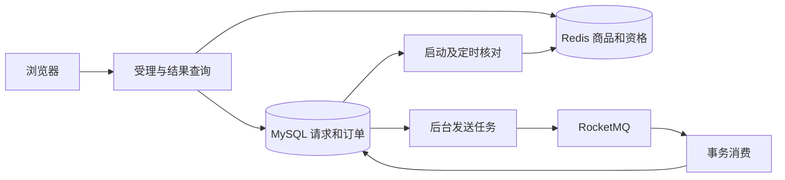

# Lab2 商品秒杀系统

《架构驱动的软件开发实践》实验二的小项目，以同一秒杀案例逐步实践 MySQL、Redis、RocketMQ。当前版本 `0.3.0-async`，本机数据库版、缓存版与异步版已完成。阶段 E 的本机功能和性能对比、阶段 F 的 ECS 部署与功能验证已完成；RDS 入门实践待资源。

本机页面：<http://127.0.0.1:18092/>。用户编号是实验身份标识，未实现登录认证、真实支付或物流。

云端页面：建立 SSH 本地转发后访问 <http://127.0.0.1:18094/>，与本机数据库分开运行。实际部署、资源限制、重启验证与演示步骤见 [ECS 部署说明](deploy/ecs/README.md)。云端未开放新的公网 HTTP 端口；本地标签 `stage-f-deployed` 对应本阶段材料。

## 版本与结构

| 本地标签 | 实现 |
| --- | --- |
| v0.1.0-db | MySQL 事务、库存条件更新与唯一约束 |
| v0.2.0-cache | 商品旁路缓存、Lua 原子预扣与回滚补偿 |
| v0.3.0-async | 持久请求/Outbox、异步落单、结果查询、幂等与恢复 |



HTTP 202 代表持久请求已受理，消息可能尚未发送；只有 SUCCESS 与订单存在才表示购买成功。受理仍取得活动行锁并访问数据库，未据此宣称消除数据库瓶颈或提高性能。

## 实测环境

- Windows、Java 17.0.20.1、Maven 3.9.16、MySQL 8.0.46。
- Spring Boot 3.5.16、MyBatis Starter 3.0.5。
- 本机 Ubuntu 24.04 WSL2：Redis 7.4.8、Apache RocketMQ 5.5.1。
- Remoting Java 客户端 5.5.1；NameServer + 单 Broker；该路径不需要 Proxy，Dashboard 未实施。

## 准备与启动

需 Java 17、Maven、Python 3、本机 MySQL 和默认 Ubuntu WSL。WSL 安装器针对本次实验环境，需要发行版管理员权限与下载网络，不是通用服务器安装器。

```powershell
python scripts/init_db.py
python scripts/prepare_redis_wsl.py
python scripts/prepare_rocketmq_wsl.py
python scripts/mq_admin.py topics
python scripts/lab.py test
python scripts/lab.py build
python scripts/lab.py run
```

数据库初始化交互读取管理员密码，仅建独立库、最小权限应用账户及表，种子数据 INSERT IGNORE，不重置已有库存。管理员密码不保存。应用配置位于项目外 `../实验记录/本机私用/app-env.json`。`.env.example` 仅列变量，不会被 Spring 自动读取；`lab.py` 读取私用 JSON 注入进程环境，支持 `--env-file`、`--maven`，工具路径可用 JAVA_HOME、MAVEN_BIN、MYSQL_BIN 指定。

RocketMQ 官方 ZIP 经 SHA-512 完整核对后安装。服务 lab2-mq-namesrv、lab2-mq-broker，数据在 WSL /var/lib/lab2-rocketmq/store。9876、10911、10909 绑定回环；HA 10912 实测通配监听，安装器为该端口设置 IPv4/IPv6 非回环丢弃规则，并在 Broker 启动前确保存在，未修改其他网络规则。配置在 deploy/rocketmq/install-wsl.sh；不使用默认大内存启动脚本。

运行入口保持 WSL 活跃，使用项目外按 SHA-256 命名的 JAR 副本，避免 Windows 锁住下一次构建；前台 run 以 Ctrl+C 停止。后台演示可用 `python scripts/local_app.py start|stop|status`；停止前核对进程清单与命令行。`start --consumer paused` 仅用于恢复实验；恢复消费者时停止后按默认参数启动。

## 验证

集成测试前停止所有使用同一实验库的异步应用，包括其他端口的副本。测试用专用活动号、Redis 前缀和 MQ Topic，但共享持久请求表；演示发送任务不能同时读取测试请求。入口检查默认端口并阻止这种误用。

```powershell
python scripts/lab.py test
# 三条独立消息，不启动 Spring/MySQL/Redis
java -jar target/seckill-lab2-0.3.0-async.jar mq-demo
# 先启动应用；会保留一笔真实实验订单
python tests/verify_async_http.py --output ../实验记录/异步HTTP验收.json
python scripts/inventory_snapshot.py --output ../实验记录/异步库存快照.json
```

最终 38 项测试通过：数据库 8、Redis 15、Redis 故障 2、异步流程 10、真实 Broker 3。另验证消费者停止期间受理、应用重启恢复、实际 Broker 停止与恢复，以及 Edge 页面状态。阶段 E 已按三个历史标签完成固定并发、三轮重复的本机性能比较；原始请求、资源采样和库存快照另存。结果见[阶段 E 性能分析](docs/阶段E结果/性能分析.md)，复现见[测试说明](tests/README.md)。

同步检查 tests/verify_http.py 应在历史标签运行，不适用于默认异步接口。

## 主要接口

| 接口 | 含义 |
| --- | --- |
| GET /health | 数据库、Redis、消息客户端启动状态；不证明 Broker 在线 |
| GET /api/products/{id} | 商品与 X-Product-Cache MISS/HIT |
| GET /api/activities | 活动与可分配库存（数据库剩余减 ACCEPTED） |
| POST /api/activities/{id}/orders | userId、requestId；新受理 202、已有终态 200 |
| GET /api/requests/{requestId}?userId=… | ACCEPTED / SUCCESS / FAILED |
| GET /api/requests?userId=… | 最近 30 条请求，找回处理中编号 |
| GET /api/orders?userId=… | 成功订单 |

同编号重试不重复预扣。同活动/用户仅一条受理记录，包括 FAILED；失败后查询原结果，不自动换编号抢购。更换用户编号不构成真实权限隔离。

## 设计、恢复与限制

- [数据库版设计](docs/数据库版设计与验证.md)
- [缓存版设计](docs/Redis缓存版设计与验证.md)
- [异步版设计、恢复与云产品学习](docs/RocketMQ异步版设计与验证.md)

默认开启异步与 Redis。不同版本不得同时修改同一批活动。正常演示无需重置；sql/05_reset_demo.sql 会删除活动 1–5 的订单与请求，须停流、保存结果并核对未完成请求后人工执行，再仅删除对应 v3 活动库存键并重启。禁止 FLUSHDB，不自动清空 Broker。

采用持久 Outbox、至少一次投递与数据库幂等；未实现跨存储原子提交或端到端“恰好一次”。单机、单 Broker 不提供高可用；数据库丢失、永久错误和长期故障仍需人工处理。真实配置、密码、服务器私用材料及原始证据不进入 Git；尚未推送 GitHub。
