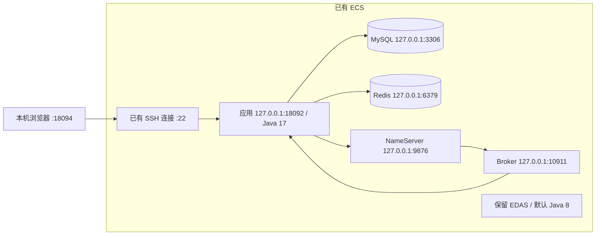

# ECS 部署与演示说明

2026-10-31 在已有 ECS 完成部署与功能验证，业务版本 `0.3.0-async`。云端使用独立实验库，初始库存 30；最终快照为 3 笔订单、MySQL/Redis 各剩余 27、ACCEPTED/PENDING 各 0、库存差额 0。本机原 8 笔订单与云端数据分开保存。

没有购买云产品，没有将 ECS 自建 MySQL 记为 RDS 实践，也没有开展 ECS 性能压测。

## 实际方案与环境

| 项目 | 本次配置 |
| --- | --- |
| ECS | Ubuntu 22.04.5，2 vCPU，实测内存 3623 MiB、Swap 4095 MiB、根盘 40 GiB |
| 应用与 MQ 运行时 | 独立 Temurin JRE 17.0.21+9；本机开发 JDK 为 17.0.20.1 |
| MySQL | 8.0.46-0ubuntu0.22.04.4，REPEATABLE-READ |
| Redis | 官方 APT 7.4.8，专用 systemd 服务，AOF everysec，96 MiB/noeviction |
| RocketMQ | 5.5.1，NameServer + 单 Broker，SYNC_FLUSH，无 Proxy/Dashboard |
| 消息与缓存隔离 | Topic Lab2OrdersV3，组 lab2-orders-ecs-v3，键前缀 lab2:ecs:v3: |
| 保留的平台 | 默认 Java 8 路径不变；EDAS Agent 在部署前后为同一进程 |

核查时未安装 Docker，也没有已有 MySQL/Redis 业务，因此采用原生安装与 systemd 管理。与容器方案相比，少引入容器运行环境，但需自行管理组件、日志、持久数据与升级。与 RDS/托管 Redis/MQ 相比，复用已有资源，同时承担单机故障和资源竞争的限制。



业务 HTTP、数据库、Redis、MQ 主端口均仅监听回环地址。Broker HA 10912 实测为通配监听，使用 IPv4/IPv6 非回环丢弃规则，并由 Broker 启动前脚本维护；不据此声称该端口绑定回环。没有新增安全组规则，没有修改 SSH 配置。

## 路径与资源配置

| 内容 | 路径 |
| --- | --- |
| 部署材料 | /opt/lab2-seckill/staging |
| JAR 与当前版本 | /opt/lab2-seckill/releases/v0.3.0-async-e199b42/app.jar；current 符号链接 |
| 独立 Java | /opt/lab2-seckill/java17/bin/java |
| 应用配置与组件密码 | /etc/lab2-seckill/app.env、credentials.json；目录 0700，文件 root:root 0600 |
| Redis 配置/数据 | /etc/redis/lab2.conf（root:redis 0640）；/var/lib/redis/lab2 |
| MySQL 数据 | /var/lib/mysql；独立库 lab2_seckill |
| MQ 安装与数据 | /opt/lab2-rocketmq；/var/lib/lab2-rocketmq/store |
| 应用工作目录 | /var/lib/lab2-seckill |
| 日志 | systemd journal；两个工作目录下 logs/rocketmqlogs；另配置 logrotate |

应用与 MQ 使用不可交互登录的 lab2 账户。应用数据库账户仅有实验库 SELECT/INSERT/UPDATE/DELETE 权限；root 仅在服务器本机通过 socket 初始化和管理，不保存数据库管理员密码。

| 服务 | systemd MemoryHigh / MemoryMax（MiB） | JVM 最大堆 |
| --- | --- | --- |
| mysql | 512 / 768 | — |
| lab2-redis | 128 / 160 | — |
| lab2-mq-namesrv | 192 / 256 | 128 MiB |
| lab2-mq-broker | 704 / 768 | 384 MiB |
| lab2-seckill | 512 / 640 | 384 MiB |

组件重启后的单次快照：可用内存 2114 MiB、Swap 使用 0、根盘可用约 28 GiB。该观测只支持当时的小规模演示可运行，不能外推并发容量。已配置开机启用与失败重启；本阶段实际验证了应用重启及上述五项服务停止后启动，**未在部署后重启整台 ECS 验证**。

## 首次部署复现

脚本针对本次 Ubuntu 22.04 环境，需管理员权限。先检查 CPU、内存、磁盘、默认 Java、现有进程、端口及服务归属。已有数据库、Redis、同名账户/目录或重要业务时，先单独制定迁移方案，不直接运行。系统准备脚本对未归属本项目的已有 MySQL/Redis 会退出。

1. 按项目 README 构建并验证 JAR，明确实际构建所用源码提交。本次测试 JAR 来自 `e199b42`，SHA-256 为 `dc2328ea4636d5008b94ea460507d16f7b9f027e8495e3d475dbdede1f36f7f3`。重新构建必须记录实际哈希，不能套用该值。

```powershell
# 项目根目录；输出目录不能有旧部署文件
python deploy/ecs/prepare-bundle.py --jar-source-commit e199b42 --output ../实验记录/阶段F/新部署包
```

打包器记录 JAR 来源提交、当前部署材料提交、工作区状态与实际 JAR 哈希。来源提交由构建者提供，工具不能从任意 JAR 反推出来源。

2. 通过已有 SSH/SFTP 通道，先核对控制台提供的主机指纹，再上传 app.jar 与 deployment-files.tar 至 /opt/lab2-seckill/staging。不将私用 app.env 或服务器登录密码放入包中。服务器目录由管理员创建；上传完成后执行：

```bash
install -d -m 755 /opt/lab2-seckill/staging
cd /opt/lab2-seckill/staging
tar -xf deployment-files.tar
bash prepare-system.sh
python3 fetch-assets.py
python3 configure.py
python3 ecsctl.py snapshot --output initial-snapshot.json
```

系统准备脚本保存默认 Java 路径供安装后核对，安装 MySQL 与精确版本 Redis，不切换全局 Java。下载器按 assets.json 的官方地址下载 JRE/MQ，分别核对 SHA-256/SHA-512。配置器再次核对 JAR 和归档、生成随机应用凭据、创建表与种子数据、配置五项服务、创建 4 队列 Topic 并启动。完整地址和校验值见 [assets.lock.json](assets.lock.json)；Redis 源见[官方 APT 说明](https://redis.io/docs/latest/operate/oss_and_stack/install/install-stack/apt/)。若固定包已下架，先核查官方归档与版本，不跳过校验或任意更换包。

安装器不负责版本升级、自动回滚或灾难恢复。已有 current 指向不同版本时会退出；不删除订单、不自动执行重置 SQL。MySQL 来自 Ubuntu 当前仓库，其他日期可能获得不同补丁版，须记录实际版本。本次首次安装前，已通过独立预检保存默认 Java 基线；交付脚本补入了同一基线的自动保存步骤，未为该补充重复安装服务器组件。

## 访问、演示与管理

云端通过 SSH 本地转发访问。本机 18094 与本机开发用 18092 区分。将变量填为已有地址和账户，在自己的终端交互登录，无需把密码写入文件：

```powershell
$ecsHost = '填写服务器地址'
$ecsUser = '填写已有账户'
ssh -N -L 18094:127.0.0.1:18092 -o ExitOnForwardFailure=yes -o ServerAliveInterval=30 "$ecsUser@$ecsHost"
```

保持连接后打开 <http://127.0.0.1:18094/>。这是转发到 ECS 的本机地址，不是公网业务地址。转发关闭后页面无法访问，云端 systemd 服务仍独立运行。演示用户编号不是登录认证。

演示时选择合法的新用户编号，查看活动、提交一次、查询成功并核对库存。演示会新增真实实验订单，不能始终宣称仍为 3/27。已有用户 ecs_demo_1001、ecsF_recover_6ae2fa7e27e0 可只读查询。

服务器管理员常用操作：

```bash
systemctl status lab2-seckill lab2-redis lab2-mq-namesrv lab2-mq-broker mysql --no-pager
systemctl stop lab2-seckill
systemctl start lab2-seckill
python3 /opt/lab2-seckill/staging/ecsctl.py restart-app --output /var/tmp/lab2-after-restart.json
journalctl -u lab2-seckill -n 100 --no-pager
python3 /opt/lab2-seckill/staging/ecsctl.py snapshot --output /var/tmp/lab2-snapshot.json
```

消费者暂停/恢复用于有意的故障实验，会重启应用；恢复后继续查询**原请求编号**：

```bash
python3 /opt/lab2-seckill/staging/ecsctl.py pause-consumer --output /var/tmp/lab2-paused.json
python3 /opt/lab2-seckill/staging/ecsctl.py resume-consumer --output /var/tmp/lab2-resumed.json
```

CLIENTS_STARTED 表示消息客户端已启动，不等于 Broker 当前在线或所有请求已完成。恢复命令刚返回时仍可能 ACCEPTED；本次启动快照确有该过渡状态，之后原请求成为 SUCCESS。须继续查询订单，等 ACCEPTED/PENDING 为 0 后核对。

`ecsctl.py restart-components` 停止并启动本项目应用、Broker、NameServer、Redis 和 MySQL。本次 MySQL 为新装实验服务，不要在共享生产数据库上直接使用此操作。持久化不等于备份；本次只验证有序重启，没有验证掉电、磁盘丢失或跨机恢复。

## 实际验证与案例分析

| 场景 | 实际结果 |
| --- | --- |
| 接口与页面 | 正常购买、原编号重试、重复购买、无效活动/用户、活动时间和售罄限制通过；页面真实生成第二笔订单 |
| 应用重启 | 原两笔订单编号不变，MySQL/Redis 各剩余 28 |
| 消费者关闭后提交 | HTTP 202，原请求 ACCEPTED、该用户成功订单 0；数据库剩余 28、可分配库存 27 |
| 消费者恢复 | 同一请求三次发送对应三条消费日志，仅生成一笔订单 |
| 五项服务停止后启动 | 3 笔原订单保留；MySQL/Redis 各 27，ACCEPTED/PENDING 各 0，库存差额 0 |

接口脚本两条轨迹合计 45 次 HTTP 调用（20 + 25；恢复结果文件已包含暂停阶段 19 次，不能重复相加）。这是含查询与重试的调用次数，不是 45 项独立测试，页面操作另行留证。组件重启后另行只读核对原订单。

同一案例在云端落实了数据库最终约束、Redis 资格预扣、MQ 异步消费与持久请求恢复。消费者停止时页面只显示受理；恢复后用原 requestId 关联消息和唯一订单。三次发送未产生三笔订单，支持本次场景的消费幂等结果，不代表端到端“恰好一次”。全部组件同机，仍有单点故障和资源竞争，未实现生产认证、真实支付或高可用。

原始 JSON、云端 journal、资源与权限核查、三张关键截图保存在仓库外 lab2/实验记录/阶段F 与 lab2/实验证据/阶段F。报告须结合这些材料注明时间、场景和运行位置，不以单独页面截图证明物理部署地点。
