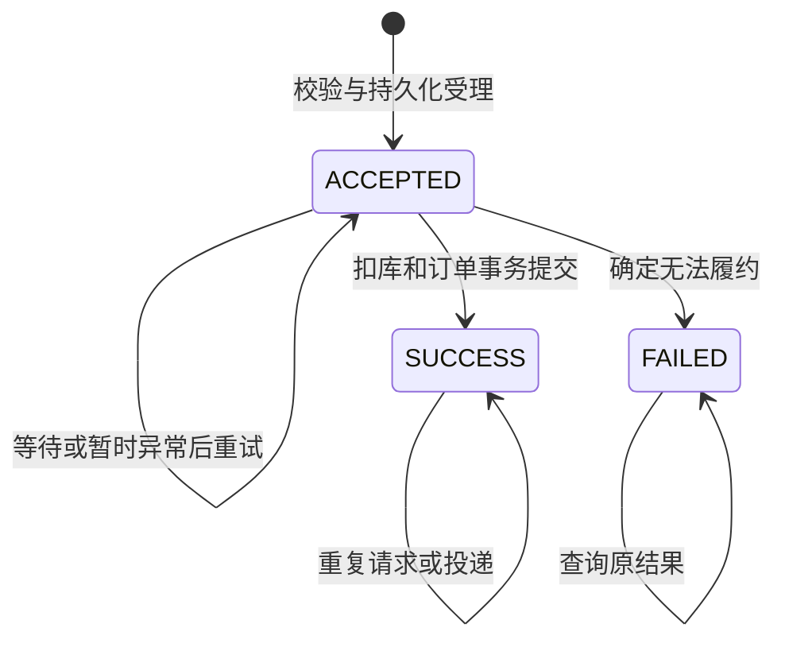

# 阶段 D：RocketMQ 基础与异步秒杀

日期：2026-10-30。范围：本机安装、Java 消息收发、异步业务、故障恢复及云产品资料学习。未创建云实例，未部署 ECS，性能比较留待阶段 E。

## 1. 概念、方案与安装

Producer 发送，Broker 保存并提供消费，Consumer 处理；Topic 区分业务，Tag 细分；NameServer 提供路由。消费组区分消费业务，本项目并发集群消费。业务 requestId 写入消息 Key 与 JSON 体，Broker 返回 messageId；订单保存 requestId，支持贯穿查询，两个编号不能混同。

| 方案 | 覆盖与维护 | 决定 |
| --- | --- | --- |
| 本机 WSL 自建 | 覆盖本机安装和真实收发，需本机资源与服务维护 | 已实施 |
| 已有 ECS 自建 | 利用已有服务器，组件共享资源，需端口/数据/备份管理 | 阶段 F 再确定配置 |
| 云托管 RocketMQ | 需实例、网络、认证和费用核对，减少部分服务维护 | 已学习流程，未开通 |

采用 Apache RocketMQ 5.5.1、JRE 17、经典 Remoting 客户端 rocketmq-client:5.5.1。该路径部署 NameServer 与单 Broker，不运行 gRPC Proxy；Dashboard 不实施。本机成功不表示配置可直接用于云实例。

官方 ZIP 经完整 SHA-512 核对后解压。NameServer 堆上限 128 MiB、Broker 384 MiB、直接内存 128 MiB；CommitLog 文件 16 MiB，SYNC_FLUSH，配置保留 24 小时。参数用于本机演示，不是容量建议。单 Broker、无 Slave、无故障转移；持续关注积压与磁盘。

9876、10911、10909 实际绑定回环。HA 10912 不能仅靠 bindAddress 约束，实测为通配监听，故为此端口配置 IPv4/IPv6 非回环丢弃规则并在服务启动前确保存在；不改 Windows 防火墙或 ECS。安装文件在 deploy/rocketmq/，下载与管理入口在 scripts/。

显式创建三个 Topic，各 4 个读/写队列：独立示例 Lab2MessageDemo、业务 Lab2OrdersV3、测试 Lab2OrdersV3Tests。关闭自动建 Topic；业务组 lab2-orders-v3，测试另组。

## 2. 契约与持久请求

浏览器生成 UUID requestId，新增 seckill_request，兼作状态账本与 Outbox。字段包含活动/用户、资格 token、受理商品名/价格、状态、失败码、订单号、下次发送时间、发送尝试数、最近 messageId、已提交处理次数和 Redis 修复标志。主键 requestId，活动/用户联合唯一。

未开始、结束、未开放、售罄、参数错误在受理前拒绝，不插入请求。编号已用于别的用户/活动返回冲突；同用户新编号不能再次受理。FAILED 记录仍占用活动/用户唯一资格，不自动释放为新一次抢购。

首次 HTTP 202 + ACCEPTED 代表请求已持久化，尚不保证 Broker 接收或订单成功。SUCCESS 返回订单，FAILED 返回失败码。前端区分“受理中”和“购买成功”；轮询约 30 秒后提示稍后查询，不把等待超时改成业务失败，也不自动换编号。最近请求列表可找回处理中编号。

## 3. 实现流程

1. **受理**：先锁活动行，再进行一致性读，检查历史订单、请求、活动有效期。从 MySQL 剩余减 ACCEPTED 重建 Redis，再 Lua 原子预扣，最后写持久请求。受理事务回滚才尝试补回 token；不确定窗口交给账本重建。
2. **发送**：每约 2 秒扫描到期 ACCEPTED，条件更新取得 10 秒租约，再同步发送。失败约 2 秒后可再试；发送成功仍未完成的约 30 秒后再投。发送确认即使晚于消费提交，也保存 messageId 而不重新打开终态。
3. **消费**：消息取 requestId，查询持久行，按活动→请求顺序加锁。终态直接确认；事务内扣 MySQL、插入订单、标 SUCCESS。库存条件更新和订单唯一约束保留。合法受理后排队跨结束时间仍履约，商品名与价格使用受理快照。
4. **修复**：提交后幂等结束 Redis token，成功才置 redis_done。Redis 失败不撤回成功订单，定时重试；启动及约每 15 秒按活动重建库存和待处理 token。重建持有活动行锁，依权威账本计算，不对未知提交结果盲目加库存。

受理和消费均持活动行锁；同一活动串行受理，每次重建 Hash 与待处理请求数相关。这是小规模课程实现的恢复取舍，受理仍访问数据库，没有证明更高吞吐。

## 4. 库存与故障窗口

稳定时：初始库存 = MySQL 剩余 + 成功订单数；Redis 可分配 = MySQL 剩余 - ACCEPTED。API 展示可分配值。有排队请求时，MySQL 与 Redis 不应简单相等。跨系统取样应在停流或处理完成后核对。

| 窗口 | 状态与恢复 |
| --- | --- |
| Redis 预扣后受理事务未提交 | 无持久请求；回滚补偿或重建移除孤立 token |
| 已受理、发送前进程退出 | MySQL ACCEPTED，重启后到期扫描 |
| Broker 已接收、发送结果未知 | 保留原请求重发，允许重复消息 |
| 消费事务异常 | 请求仍 ACCEPTED，扣库和订单回滚，返回 RECONSUME_LATER |
| 消费已提交、消息确认前退出 | 重投发现 SUCCESS，直接确认 |
| MySQL 成功、Redis 修复失败 | SUCCESS 不变，redis_done=0，后续修复与重建 |
| 确定库存不足/购买冲突 | FAILED 可查，释放或重建资格 |

消费重投上限设为 3，暂时异常返回重试；Outbox 对仍 ACCEPTED 的请求也会继续投新消息。永久错误可能持续重试，需要人工调查。没有生产级退避、熔断、告警、死信管理或人工重放界面，不承诺固定完成时限。

未知 requestId 记录告警后确认，常见于测试清理后的旧消息；JSON 无法解析返回重试。它不是数据库账本丢失后的恢复方案：消息只有编号，无法重建丢失订单数据。processing_attempts 是事务成功提交的处理次数，回滚的尝试不计入，不能用它替代消费重投次数。

## 5. 实际验证

最终 38 项测试：数据库 8、Redis 15、Redis 故障 2、异步流程 10、真实 Broker 3。流程测试用真实 MySQL/Redis，覆盖持久受理、10 次重复处理、同编号重试、受理/消费回滚、Redis 丢键/孤立 token、跨结束时间履约、确定失败、16 请求抢 4 资格，以及消费先于发送确认的竞态。并发仅验证正确性。

三项 Broker 测试覆盖暂停后恢复和真实重复投递、注入一次发送异常后的真实补发、注入一次消费异常后的真实 Broker 重投。注入异常用于触发路径，不冒充物理断网。

独立 Java 程序不启动 Spring、不连接 MySQL/Redis，实际发送并核对三条消息。日志逐条保存 PRODUCED/CONSUMED 的 Key、messageId 与消息体，最终 ROUND_TRIP_VERIFIED count=3。

另做实际应用/组件操作：

| 场景 | 观察 |
| --- | --- |
| 消费者停止，生产者正常 | HTTP 202，ACCEPTED，无新订单；MySQL 26、Redis 25、待请求 1，消息已发送 2 次 |
| 停止 Java 进程后恢复消费者启动 | 原编号 SUCCESS，唯一订单，重试返回原订单 |
| systemctl 停止实际 Broker | 新请求 HTTP 202；MySQL 25、Redis 24、待请求 1；无新订单、持续发送失败 |
| 恢复实际 Broker | 原请求补发并成功；该请求累计 30 次发送尝试，无重复扣库 |

故障恢复时快照为初始 30、订单 6、MySQL 24、Redis 24、ACCEPTED 0。最终构建随后新增一次 HTTP 验收和一次页面下单；最终快照为订单 8、MySQL/Redis 各 22、ACCEPTED/PENDING 各 0、差额 0。后续演示会改变快照。已结束且无待请求的活动 3 不常驻 Redis；缺键不代表库存 0。

HTTP 输出保存每次实际请求，包括轮询，检查数受等待时间影响，不能称为固定数量的独立测试用例。Edge 留存同一用户的“受理中”与“重启后成功”两图，另保存最终版本页面实际下单成功图。

项目外 实验记录/阶段D 保存 JSON、汇总与完成记录；上级保留安装、测试、构建、示例和失败日志；实验证据/阶段D 保存截图。首次 Java 示例因执行环境限制本机网络而失败，获准连接后重跑成功；保留两轮日志，不混记。

## 6. 启停与恢复

命令见 README；scripts/mq_admin.py status|stop|start|restart 仅控制本机实验 Broker，不操作 Redis/MySQL/ECS。

恢复依赖 → 检查组件 → 启动异步应用 → 查询原 requestId → 查看 OUTBOX_RETRY/MQ_SENT/MQ_CONSUMED → 等待 ACCEPTED 清零 → 核对库存/订单/redis_done。health 的 CLIENTS_STARTED 仅表示客户端生命周期启动，Broker 停止时仍可能显示此值，须用实际收发或服务状态确认可用性。

长期 ACCEPTED 时核对 send_count、next_send_at、messageId、Topic/Group/路由/磁盘及数据库错误。不能直接标 SUCCESS 或删除未履约请求；永久故障先调查并设计事务处置，没有一键强制取消功能。

重置仅供舍弃演示结果：停止全部生产/消费应用，保存并核对请求和订单，人工执行 05_reset_demo.sql 删除 1–5 请求/订单并重置活动，再只删除对应 v3 活动键，启动重建。UUID 不复用，不自动清 Topic，不 FLUSHDB。历史标签使用各自 SQL 与说明，不能混跑同一活动。

测试也要求停止其他异步副本：专用活动/前缀/Topic 并不能隔离共享请求表的后台扫描；入口只自动检查默认端口，其余副本需自行确认。

## 7. 云 RocketMQ 学习

核对实例类型、地域与网络 → 准备实例/Topic/消费组 → 获取对应协议接入点与认证条件 → 选择 SDK → 发送业务 Key 消息并核对消费与监控。Topic 类型匹配消息类型。见[阿里云资源准备](https://www.alibabacloud.com/help/en/apsaramq-for-rocketmq/cloud-message-queue-rocketmq-5-x-series/getting-started/step-2-create-resources)和[Java 收发入门](https://help.aliyun.com/zh/apsaramq-for-rocketmq/cloud-message-queue-rocketmq-5-x-series/getting-started/step-3-use-sdks-to-send-and-receive-messages)。

本机采用 Remoting rocketmq-client。云文档同时提供 gRPC rocketmq-client-java，后者配置 endpoints；不能按名称互换依赖或接入点。认证、命名空间、公网条件按实际实例核对，迁移需改配置/代码并实测，参见[云 Spring 接入说明](https://help.aliyun.com/zh/apsaramq-for-rocketmq/apsaramq-for-rocketmq-spring-boot-access-quick-start)。本阶段只有资料学习，没有创建/购买/连接云 RocketMQ，不更新阶段 A 资源查询结论。

## 8. 秒杀案例分析

异步化分开受理与订单完成，提供可查状态，允许暂时消息故障后继续处理。可靠性依靠 MySQL 持久请求、Outbox、事务与幂等，Redis 资格可由账本重建。HTTP 202 耗时不能代替端到端订单完成耗时，功能成功也不证明性能提升。

未采用 RocketMQ 事务消息，未实现跨存储原子提交；至少一次投递与业务幂等不能称作端到端“恰好一次”。没有支付、鉴权、限流、多机高可用；单 Broker/数据库损坏或账本丢失仍有不可恢复风险。长期重试可积压，活动行锁和待请求全量重建限制吞吐。阶段 E 分别测受理、处理、端到端指标。

## 官方参考

- [Apache Quick Start](https://rocketmq.apache.org/docs/quickStart/01quickstart/)
- [5.5.1 发布](https://rocketmq.apache.org/release-notes/2026/08/20/5.5.1/)
- [经典 Producer 概念](https://rocketmq.apache.org/docs/4.x/producer/01concept1/)
- [经典 Push Consumer](https://rocketmq.apache.org/docs/4.x/consumer/02push/)

4.x 文档栏目用于经典客户端 API，本次实际服务器为 5.5.1，未安装 4.x。
