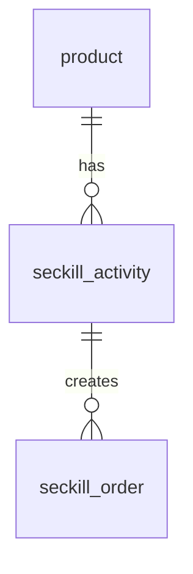

# 数据库基础版：设计与验证

版本：0.1.0-db；验证日期：2026-10-30。

## 1. 范围与数据模型

实现活动查询、同步事务下单、每场每人限购一件、同一请求重试返回原订单、用户订单查询。前端用实验用户编号模拟身份，不属于正式登录认证；请求查询中的用户参数也不能替代身份鉴权。

| 表 | 主要字段 | 约束与职责 |
| --- | --- | --- |
| product | id、name、description、regular_price | 商品资料，价格大于零 |
| seckill_activity | product_id、seckill_price、initial_stock、stock、start_time、end_time、status | 秒杀价格、分配给该活动的库存、开放区间与状态；库存不得为负或超过初始值 |
| seckill_order | id、request_id、activity_id、user_id、product_name、unit_price、quantity、status、created_at | 保存购买时的名称和价格快照；请求编号唯一；活动与用户组合唯一；数量固定为 1 |

这里库存属于活动分配库存，不额外维护商品总仓库存。每个活动可独立分配同一商品的演示库存。

订单状态只有 SUCCESS，因为本版在数据库事务提交完成后才向调用方返回成功。后续异步版再增加请求受理与处理状态，不预先声称已有队列处理。

## 2. 下单过程

1. 接收 activityId、userId、requestId；限制编号格式，价格和数量不由客户端指定。
2. 在 Spring 事务中查询并锁定活动行。
3. 相同 requestId、相同用户和活动已经有订单时返回原订单；编号用于其他请求时拒绝。
4. 检查该用户是否已经购买，再检查活动状态、数据库时间与剩余库存。
5. 使用带库存、状态、时间条件的 UPDATE 扣减一件库存，检查影响行数。
6. 插入订单，保存名称和价格快照。唯一约束是最后一道重复数据保护。
7. 事务提交成功后返回订单。异常时库存和订单同时回滚。

同一活动的请求按活动行锁串行处理。这是以清晰的正确性保障作为基础版本的选择，会限制热点活动吞吐量。后续引入 Redis、RocketMQ 时仍保留数据库约束，而不是移除最终数据保障。

活动时间采用左闭右开区间 `[start_time,end_time)`，以数据库当前时间判断。条件更新会再次核查时间，覆盖锁等待期间活动过期的情况。连接时区使用 `+08:00`，通过 URL 编码 `%2B08:00` 传入。

## 3. MyBatis 与 Hibernate 学习比较

| 维度 | MyBatis | Hibernate / JPA |
| --- | --- | --- |
| 映射方式 | 显式 SQL 与对象结果映射 | 实体及关系映射，常规 SQL 可由框架生成 |
| 本案例库存更新 | 可直接表达带库存和时间条件的更新及行锁查询 | 可用锁和自定义更新实现，需要明确持久化上下文与事务语义 |
| 适用考虑 | 便于在报告中对应 SQL、事务和影响行数 | 有利于关系模型映射及常规实体操作 |
| 本实验选择 | 实际实现与验证 | 学习和方案比较，不声称已实现第二套业务 |

选择 MyBatis 是为了让数据库基础、约束与并发操作更直观，不代表其他框架不能实现相同业务。框架不会自动替代业务层的库存和重复购买规则。

## 4. 接口

| 方法 | 路径 | 行为 |
| --- | --- | --- |
| GET | /health | 检查应用与数据库连接，返回版本与模式 |
| GET | /api/activities | 返回活动列表及数据库时间对应的状态 |
| GET | /api/activities/{id} | 查询活动，不存在返回 404 |
| POST | /api/activities/{id}/orders | JSON 包含 userId、requestId；同步事务下单 |
| GET | /api/orders?userId=... | 查询实验用户最近 100 笔订单 |
| GET | /api/orders/by-request/{requestId}?userId=... | 查询指定实验用户的请求结果 |

相同请求重试成功返回相同订单；新请求重复购买返回 409。活动无效、未开始、已结束、售罄均被拒绝。参数格式错误返回 400；数据库锁竞争失败可返回 503，由调用方使用原请求编号重试。

## 5. 实际验证

真实环境：Windows 11，Java 17.0.20.1，Maven 3.9.16，MySQL 8.0.46，隔离级别 REPEATABLE-READ。应用使用独立最小权限账户，未使用内存数据库代替 MySQL。

8 项集成测试通过：

- 正常下单及相同请求幂等重试。
- 同一用户不同请求重复购买被拒绝。
- 未开始、已结束、停用及不存在活动被拒绝。
- 查询结果不返回另一用户订单（仅验证参数匹配，不代表身份鉴权）。
- 外层事务模拟失败，已执行的扣减与插单全部回滚。
- 32 个请求、12 个工作线程竞争 8 件库存：8 笔成功，24 次售罄，库存为 0。
- 同一用户的 16 个并发请求：1 笔成功，15 次重复购买拒绝，只扣减 1 件。
- 请求编号与其他活动冲突时拒绝，不扣减目标活动库存。

测试使用 900001–900010 的专用活动区间，并在每次测试前后清理这些测试记录，不删除展示活动 1–5 的订单。该区间须保留给自动化测试。

18 项 HTTP 检查通过，覆盖数据库健康、查询、成功下单、相同请求重试、重复购买、各活动状态、非法参数及结果查询。脚本保留一笔独立验证用户的真实实验订单。

Edge 页面实际完成 demo_1001 下单、订单展示、重复购买拒绝与库存刷新。核查时活动 1 初始库存 30，接口验证与页面各产生 1 笔订单，最终剩余 28；库存核对差额为 0。后续演示会改变这些瞬时数据。

以上并发用例用于小规模正确性验证，未测试系统容量，不据此给出吞吐量或性能提升结论。

## 6. 实际问题与限制

- 初次 JDBC 连接将 Asia/Shanghai 强制设为服务器会话时区，本机 MySQL 因命名时区未配置而拒绝；改为 UTC+08:00 偏移后测试通过。未修改全局时区或导入系统时区表。
- 目前没有 Redis、消息队列、支付、正式认证或自动故障补偿。请求受理、排队、落单分离留在后续阶段。
- 初始化脚本不自动重置已有库存，应用启动不自动执行 DDL 或清空表。
- RDS 入门实践待资源；本机 MySQL 结果不能作为 RDS 成果。

## 7. 原理参考

- [MySQL 8.0 锁定读与 FOR UPDATE](https://dev.mysql.com/doc/refman/8.0/en/innodb-locking-reads.html)。
- [Connector/J 日期与时间连接参数](https://dev.mysql.com/doc/connector-j/en/connector-j-connp-props-datetime-types-processing.html)。
- [MyBatis 官方介绍](https://mybatis.org/mybatis-3/)。
- [Hibernate ORM 官方介绍](https://hibernate.org/orm/)。

这些资料解释机制；本项目实现与测试结果以上述实际代码和记录为依据。

