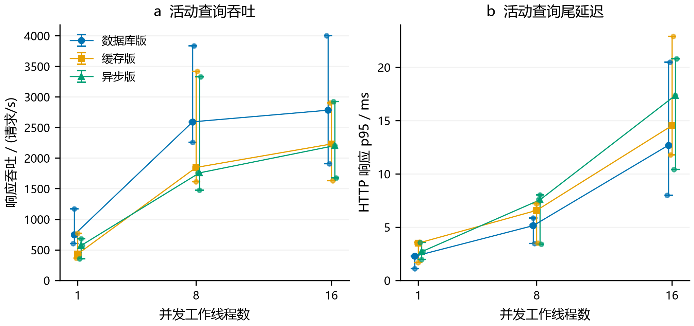
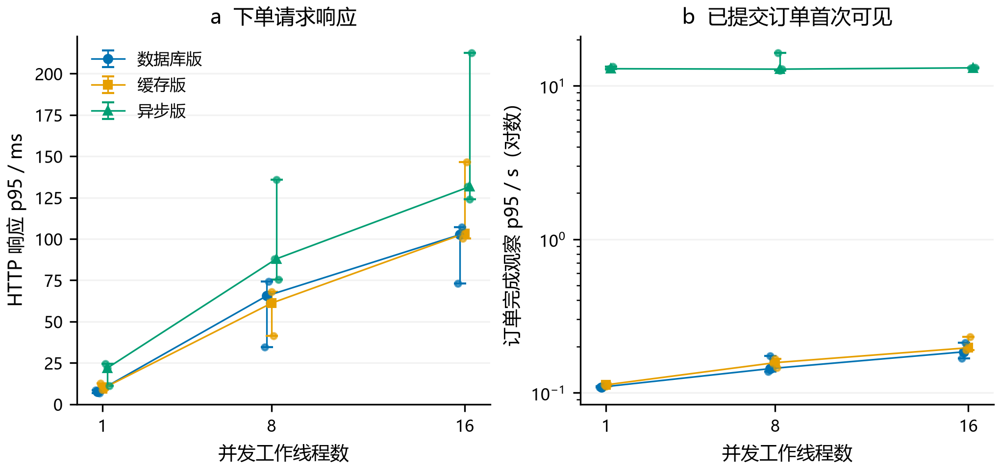
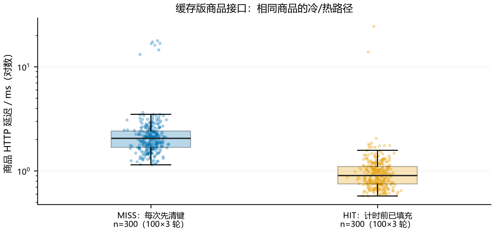
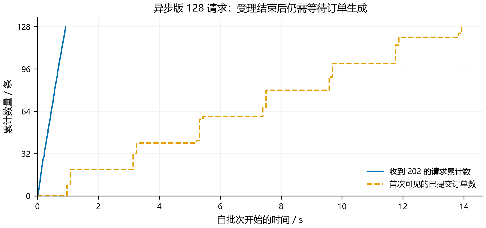

# 阶段 E：功能测试与性能分析

实际测试时间：2026-10-30T23:27:11.136474+08:00 至 2026-10-30T23:34:27.885406+08:00。运行编号 97ea089c5a。本机 Python 闭环施压，未使用 PTS 发起压测。

## 方法与可复现材料

测试条件在[固定方案](../阶段E固定测试方案.md)中于运行前确定。三个原始标签单独导出、重跑测试并构建：8/25/38 项全部通过，合计 71 次测试执行，包含跨版本重复用例，并非 71 个独立用例。

主机 8 核/16 逻辑处理器，内存 15.8 GiB；Java 17，JVM 128–384 MiB，数据库池上限 12。MySQL 位于 Windows，Redis/RocketMQ 位于同机 WSL；施压器也在同机运行。全部组件实际版本、提交号、JAR 校验值见 provenance.json。每个版本/并发组合有 3 轮，版本与并发顺序轮换；查询预热 1 秒，每轮读 4 秒，写另预热 16 单，再以新活动发 128 请求。它是短时课程实验，不是稳态容量评估。

正式样本共 **204,678 次 HTTP 请求**，覆盖 27 个查询窗口、27 个下单批次及 600 次缓存探测；不包含预热、功能矩阵、缓存控制请求和 SQL 观察。正式未知错误为 **0**。全部 27 个下单批次各 128 单，合计 **3456 单**，初始库存、剩余、订单和待处理请求核对通过。未删除长尾样本。

所有表格的“中位数”均先按轮次计算相应指标，再取 3 轮中位数；范围为实际最小至最大，不是置信区间。图中显示各轮原始点、中位数和最小/最大范围，连线仅帮助阅读测试档位，不用于外推。

## 功能与故障正确性

三个版本的正常下单、相同请求重试、重复购买、他人结果查询、未开始/结束/停用/售罄、参数错误均通过 HTTP 断言。各版的 32 请求抢 8 份库存均为 8 单、24 次售罄；同用户 16 个不同编号并发仅生成 1 单。

本阶段重跑异步版 38 项测试，其中真实 Broker 测试再次覆盖暂停消费后恢复、重复投递、注入发送异常后的补发、注入消费异常后的 Broker 重投。实际服务停止/恢复证据沿用阶段 D 同一源码的记录，未声称在本轮性能测量中再断开 Broker。确定失败与事务回滚也包含在回归中。

## 活动查询

| 版本 | 并发 | 响应 RPS 中位数 [最小,最大] | HTTP p95 中位数 / ms |
| --- | --- | --- | --- |
| 数据库版 | 1 | 747.8 [603.1, 1171.0] | 2.27 |
| 数据库版 | 8 | 2592.2 [2258.8, 3832.3] | 5.14 |
| 数据库版 | 16 | 2782.5 [1906.9, 3999.3] | 12.69 |
| 缓存版 | 1 | 431.4 [366.7, 768.8] | 3.50 |
| 缓存版 | 8 | 1846.1 [1616.1, 3419.5] | 6.57 |
| 缓存版 | 16 | 2229.7 [1632.2, 2901.7] | 14.52 |
| 异步版 | 1 | 569.4 [354.1, 680.9] | 2.69 |
| 异步版 | 8 | 1757.8 [1474.5, 3330.2] | 7.56 |
| 异步版 | 16 | 2203.0 [1675.7, 2926.7] | 17.35 |

图 1：三个版本、1/8/16 并发，各 n=3 轮；范围为 min–max。此接口始终查询活动动态数据，缓存版增加商品缓存访问，异步版还计算待请求占用，三者并非只切换一个组件的纯因果消融。波动和访问路径都必须纳入解释，不能从部分轮次的差异推广生产性能。

## 下单响应与最终完成

| 版本 | 并发 | 响应 p95 / ms | 完成观察 p95 / s | 响应 RPS | 完成观察吞吐 / 单·s⁻¹ |
| --- | --- | --- | --- | --- | --- |
| 数据库版 | 1 | 7.65 | 0.109 | 173.7 | 167.86 |
| 数据库版 | 8 | 65.53 | 0.143 | 223.4 | 190.41 |
| 数据库版 | 16 | 102.56 | 0.184 | 235.5 | 233.12 |
| 缓存版 | 1 | 9.38 | 0.113 | 132.1 | 129.25 |
| 缓存版 | 8 | 61.13 | 0.157 | 170.9 | 163.22 |
| 缓存版 | 16 | 103.34 | 0.196 | 176.9 | 167.78 |
| 异步版 | 1 | 21.87 | 12.897 | 96.7 | 8.82 |
| 异步版 | 8 | 87.93 | 12.818 | 123.8 | 9.03 |
| 异步版 | 16 | 131.58 | 13.068 | 138.6 | 9.19 |

图 2：每点 n=3 轮，每轮 128 个不同用户、128 份库存。左为完整 HTTP 响应，异步为 202 受理；右为数据库已提交订单第一次被观察到的延迟，纵轴为对数。SQL 每约 100 ms 轮询，因此右侧包含观察等待与查询时间，是提交完成延迟的上界，不能用于辨别小于该粒度的提交差异。

异步版并发 16 的受理 p95 中位数为 131.58 ms，最终完成观察 p95 为 13.07 s，固定批次完成观察吞吐为 9.19 单/s。受理和订单完成不能混为同一指标；当前配置没有证明异步化提高了下单性能。

## 商品缓存路径

600 个计时样本按固定随机顺序交错；每条件 100×3 轮，全部响应头断言正确。MISS 前只删除本轮商品键，HIT 在计时前预填。控制操作不计入 HTTP 延迟，也没有据此报告 MISS 场景的 RPS。

| 条件 | n | HTTP p50 / ms | HTTP p95 / ms | 最大 / ms |
| --- | --- | --- | --- | --- |
| MISS | 300 | 2.056 | 3.303 | 17.830 |
| HIT | 300 | 0.905 | 1.482 | 24.493 |

图 3：箱体为四分位范围，中线为中位数，须线 1.5×IQR；散点包含全部样本，含长尾，纵轴为对数。300 次请求不是 300 次独立环境重复实验。这里只比较同一缓存版的两条实际路径，不能从 HTTP 耗时直接推出数据库负载下降。

## 异步完成轨迹

图 4：并发 16 中按整批完成时长居中的实际轮次（0.3.0-async-r2-write-c16），128 个请求。蓝线为收到 202，橙线为已提交订单首次可见。阶梯与当前每约 2 秒扫描最多 20 条的后台发送策略相符；fixedDelay 还包含发送/数据库操作耗时，不能把 20/2 直接当实测吞吐。活动行锁、持久请求写入和每次重建资格 Hash 也增加受理工作。本轮保留默认策略，没有为获得更好图形而调参。

## 资源观察

下表为并发 16 下单时 3 轮的指标中位数。CPU 秒为该批次直至所有订单被观察完成的累计进程 CPU 时间，RSS 为该窗口最大工作集；同步与异步窗口长短不同，不能直接比较平均利用率。

| 版本（并发 16） | 应用 CPU 秒/批 | 应用最大 RSS / MiB | MySQL CPU 秒/批 | 施压器 CPU 秒/批 |
| --- | --- | --- | --- | --- |
| 数据库版 | 0.906 | 362.2 | 0.453 | 0.109 |
| 缓存版 | 2.203 | 383.7 | 0.547 | 0.203 |
| 异步版 | 2.281 | 441.3 | 1.875 | 1.094 |

原始文件还保留约 200 ms 间隔的主机 CPU/可用内存、进程 CPU/RSS 和施压器资源。MySQL 按实际监听端口唯一定位 PID，逐样本保存身份；首轮按进程名称选取时误取了监护进程，该轮原始文件保留但 MySQL CPU 无效。本报告使用修正探针后完整重采的一轮，不混入原轮性能值。进程 CPU 百分比以单核 100% 计，可超过 100%。应用进程不包含 WSL 内 Broker/Redis 的全部成本；MySQL CPU 是进程级观察，不能归因到某一 SQL，更不等于每个接口的数据库读取次数。采样可能遗漏极短峰值。

## 可支持的结论与限制

1. 三个版本在本次场景中均满足库存和购买约束，异步已受理请求全部有终态；这是有限功能验证。
2. 当前异步受理仍依赖数据库活动锁与逐次资格重建，默认 Outbox 的小批次和间隔造成可见等待，未观察到“引入 MQ 就必然更快”的证据。
3. 活动查询结果与商品缓存探测分别解释。小商品、快速本机 MySQL、额外 Redis 往返、JVM 预热及同机负载都会影响结果；不预设缓存收益。
4. n=3 且每窗口仅 4 秒、预热较短、同机施压、闭环等待偏差、数据表随测试增长及后台任务均限制外推。没有控制操作系统缓存、温度/频率或其他桌面应用，也未消除施压器瓶颈。
5. 没有稳定目标 RPS/饱和点搜索、长时间浸泡、多机、故障期间性能或 ECS/云产品性能结果。后续若优化，应建立新版本并固定方案另测，不改写本轮原始结果。

PTS 已完成[官方压力模型](https://help.aliyun.com/zh/pts/performance-test-pts-3-0/user-guide/pressure-model)和[报告指标](https://www.alibabacloud.com/help/zh/pts/performance-test-pts-3-0/user-guide/check-pts-3-report)资料学习；本轮使用 Python，不是 PTS 报告。HTTP 202 仅能证明请求受理，PTS 业务检查点也应另查订单完成。

## 复现与文件

先准备本机环境并停止演示应用，再运行 tests/prepare_benchmark.py 导出构建，tests/benchmark.py 执行。完整命令见 tests/README.md。round_summary.csv 为 60 个分组，grouped_summary.json 保存三轮点和聚合，provenance.json 记录版本和条件；原始数据在项目外本次运行目录。图形同时导出 PNG 300 dpi、可编辑文字 SVG 和嵌入字体 PDF，绘图代码为 tests/analyze_benchmark.py。

原始库存、订单、请求按本次清单保存后才清理，展示数据须逐行与测试前一致，再恢复本机异步演示。清理执行情况以 cleanup-result.json 和阶段 E 完成记录为准，不根据本报告的生成推断清理已经执行。
